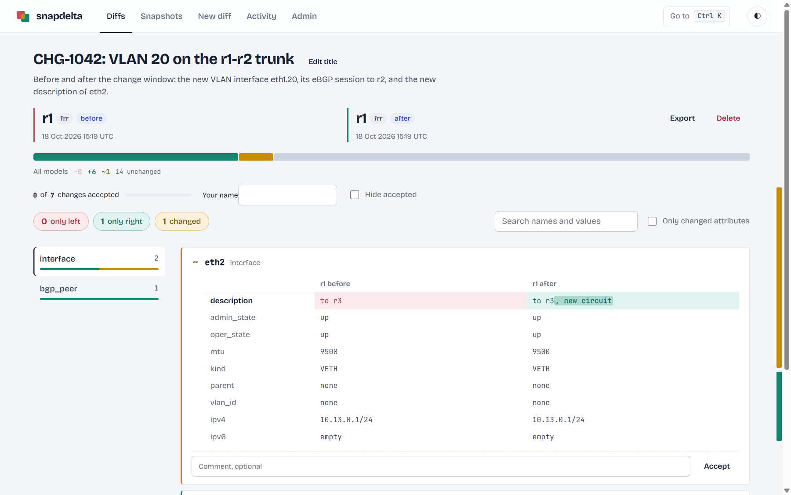
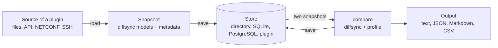

<div align="center">
  <picture>
    <source media="(prefers-color-scheme: dark)" srcset="docs/images/logo-wordmark-dark.svg" />
    
  </picture>
  <p><strong>Snapshot your devices and services, then see exactly what changed</strong></p>
  <p>snapshot &bull; diff &bull; profile &bull; inventory &bull; web UI</p>
  
  
  
  
  
  <p>
    <strong><a href="docs/getting-started.md">Getting started</a></strong> |
    <strong><a href="docs/architecture.md">Architecture</a></strong> |
    <strong><a href="docs/plugins.md">Plugins</a></strong> |
    <strong><a href="docs/profiles.md">Profiles</a></strong> |
    <strong><a href="docs/inventory.md">Inventory</a></strong> |
    <strong><a href="docs/api.md">API</a></strong> |
    <strong><a href="docs/settings.md">Settings</a></strong> |
    <strong><a href="CHANGELOG.md">Changelog</a></strong>
  </p>
</div>

Take a snapshot of anything, then compare two snapshots. A plugin brings the [diffsync](https://github.com/networktocode/diffsync) models and a source: the way to get the data of one target, from input files, an API, NETCONF or SSH. snapdelta saves each load as a snapshot, compares two snapshots on their models, not on text, and shows the diff in a web UI, a CLI and an API.

snapdelta is a plug-in architecture from end to end: the sources, the stores, the output formats, the inventories, the secret backends, the notifiers, the compare rules, the runners and the logins of the web UI are all plugins, the built-in ones included. `snapdelta plugins new` writes a plugin package that works, and `snapdelta doctor` checks it. See [docs/plugins.md](docs/plugins.md).

- **Before and after a change:** snapshot a device, apply the change, snapshot it again, and see exactly what changed.
- **Before and after a migration:** two vendors fill the same models, so the diff shows what the new device does differently, not how each vendor writes it.
- **Between two targets:** two devices of a redundant pair, two sites built from one template, a lab and production.
- **Outside the network:** a service before and after a deployment, two exports of a pipeline, two answers of an API.

## Try it in the web UI

You need Python 3.13 or later and [uv](https://github.com/astral-sh/uv). In a clone of this repository:

```bash
uv sync
uv run snapdelta-web --store /tmp/snapdelta-demo
```

Open the link that it prints, then:

1. **Snapshots**, then **Take snapshot**: source `example-live`, check **All targets**, then **Take snapshot**. The example plugin reads three simulated devices, `R1`, `R2` and `EDGE1`, from `examples/minimal-plugin/devices/`.
2. **New diff**: `R1` on the left, `R2` on the right, then **Compare**.



The diff page shows the two sides, filters and a search, and **Accept** on each change; `?` lists the keyboard shortcuts. The pages are in [docs/web-ui.md](docs/web-ui.md).

## Next steps

| You want to | Read |
|---|---|
| Compare your own data: models, one source per vendor, an inventory, the web UI | [docs/getting-started.md](docs/getting-started.md), step by step |
| See it on a live network: two FRR routers and one Nokia SR Linux in containerlab | [lab/example/README.md](lab/example/README.md) |
| Call it from a pipeline or an AI agent | [docs/api.md](docs/api.md), [docs/mcp.md](docs/mcp.md) |
| Run a shared server in a container, with your plugins | [docs/container.md](docs/container.md) |

## How it works



| Term | Meaning |
|---|---|
| Source | A plugin class that fills diffsync models: from input files, or by fetching from a target (`fetches = True`) |
| Target | What a snapshot describes: a device, a service, an API |
| Snapshot | One load of one target, saved as `TARGET/TIME-LABEL` (`R1/20260101T100000Z-before`); `R1@latest` is the newest of R1, `R1@before` the newest with the label `before`; an optional ticket (`CHG-1042`, `#216`, any text) names the work, and the labels then look inside it |
| Output | The result of one compare, saved as `TIME-LEFT-vs-RIGHT`; `-` is the left value, `+` the right value |
| Store | Where snapshots and outputs go: a directory, a SQLite file, a PostgreSQL database, or a plugin backend |
| Profile | Optional rules of a compare: ignore, tolerance (`"5%"`), counts, pairs of names |
| Inventory | Optional hosts, groups and platforms, which choose the source of each host |

## The CLI

The web UI and the CLI use the same store. The demo above, in the CLI:

```bash
uv run snapdelta --store /tmp/snapdelta-demo snapshot --source example-live --all-targets --label demo
uv run snapdelta --store /tmp/snapdelta-demo diff R1@demo R2@demo
```

To check a change on many targets, give the same ticket to the snapshots and to the diff:

```bash
uv run snapdelta snapshot --group core --label before --ticket CHG-1042
uv run snapdelta snapshot --group core --label after --ticket CHG-1042
uv run snapdelta diff --group core @before @after --ticket CHG-1042 --note "VLAN 20"
```

| Command | What it does |
|---|---|
| `snapshot` | Load input files (`FILES --source S`), or fetch targets (`--target`, `--group`, `--all-targets`, `--jobs N`); `--label`, `--ticket`, `--captured-at` |
| `diff LEFT RIGHT` | Compare two snapshots, or a snapshot and its target now (`--live`); or many targets at once, `diff --group core @before @after` (`--target`, `--all-targets`), one diff per target; `--model`, `--profile`, `--ticket`, `--note`, `--format`, `--no-save` |
| `output NAME` | Print a saved output again (`--format text`, `json`, `markdown`, `csv`) |
| `describe NAME` | Give a saved diff a ticket and a note, or change them (`--ticket`, `--note`) |
| `accept NAME KEY...` | Accept changes after a review (`--all`, `--comment`, `--undo`); the Markdown report lists them |
| `list`, `show REF` | List the snapshots and outputs (`--target` keeps the outputs whose target or ticket has this text, `--ticket` the outputs of exactly that ticket); print the data of a snapshot |
| `delete`, `prune`, `info` | Delete snapshots or outputs; keep the N newest or the last days; show the store |
| `activity [RUN]` | The runs: each snapshot and saved diff, from the CLI, the web UI, the API or MCP, with the log of its loads |
| `sources`, `models`, `inventory` | The installed sources; their models and attributes; the hosts of the inventory |
| `plugins`, `plugins new NAME`, `doctor` | The plugins of every extension point; a new plugin package to start from (`--kind source`, `store`, `format`, `inventory`, `secret`, `notifier`, `rule`, `runner`, `auth`); a check of each plugin against its interface, then of the settings, the store and the inventory (exit code 1 on an error) |
| `settings` | The settings in use and where each value comes from |

`diff` and `output` exit with `0` (no difference), `1` (differences) or `2` (error, or a target of a diff of many targets that failed), so a script can check a change. Run `uv run snapdelta COMMAND --help` for every option.

## Access to the web UI

By default, `snapdelta-web` listens on 127.0.0.1 only, refuses other host names and refuses a POST from another site. With `[web] token`, it can listen on the network: the pages then ask for the token once, and the API needs it. Behind a reverse proxy that does the login (SSO), `[web] auth = "header"` takes the user from the proxy, and the runs and the accepted changes record who did them; a plugin can add another login, such as LDAP. On an isolated network, `[web] auth = "none"` removes the login. It serves htmx, its fonts and the API docs page itself, so it works with no internet access. See [docs/api.md](docs/api.md#access).

## API

`snapdelta-web` also serves a JSON API under `/api/v1`, for a pipeline or an AI agent: take snapshots before and after a change, compare them (`R1@before` with `R1@after`, or with the target now), read the diff in any format, and give it a ticket and a note. Its OpenAPI description is at `/api/v1/openapi.json`; see [docs/api.md](docs/api.md).

```bash
curl -s -X POST http://127.0.0.1:8765/api/v1/diffs -H 'Content-Type: application/json' \
  -d '{"left": "R1@before", "right": "R1@after", "ticket": "CHG-1234"}' | jq .has_differences
```

## AI agents

An agent that talks MCP connects to `snapdelta-mcp` (stdio) or to `/mcp` of `snapdelta-web` (HTTP): tools to take snapshots, compare, read and accept changes, a guide as a resource, and prompts to check a change or review a diff. An agent that runs shell commands uses the skill `skills/snapdelta/SKILL.md`. `/mcp/docs` shows the tools and tries them, as `/api/v1/docs` does for the API. See [docs/mcp.md](docs/mcp.md).

```bash
claude mcp add snapdelta -- snapdelta-mcp --settings /path/to/snapdelta.toml
```

## Settings

snapdelta reads `snapdelta.toml`: the file given with `--settings`, else `SNAPDELTA_SETTINGS`, else `./snapdelta.toml`, else `~/.config/snapdelta/snapdelta.toml`. Every key is optional: the store, the parallel snapshots, the web UI, the inventory, the profiles, and one table per source, store backend and inventory format. `snapdelta settings` shows the values in use, and **Admin > Settings** edits them. Every key is in [docs/settings.md](docs/settings.md). The store can hold sensitive data: never commit it to a public repository.

## Guides

| Guide | Content |
|---|---|
| [getting-started.md](docs/getting-started.md) | Your own project, step by step: install, models, one source per vendor, inventory, settings, test data, web UI |
| [architecture.md](docs/architecture.md) | The parts, a diff step by step, and the extension points |
| [plugins.md](docs/plugins.md) | The plug-in architecture: each extension point, write and check a plugin, contract tests, add an extension point |
| [output.md](docs/output.md) | The output document, the diff tree, the formats, the exit codes |
| [profiles.md](docs/profiles.md) | Ignore, tolerance, counts, pairs: the rules of a compare |
| [inventory.md](docs/inventory.md) | The optional Nornir inventory: groups, platforms, host data |
| [web-ui.md](docs/web-ui.md) | The pages of the web UI, with screenshots |
| [api.md](docs/api.md) | The JSON API for pipelines and AI agents, the token and the network access |
| [mcp.md](docs/mcp.md) | The MCP server and the skill for AI agents |
| [container.md](docs/container.md) | The container image, your plugins in an image of your own, a compose file with PostgreSQL |
| [stores.md](docs/stores.md) | The file and SQLite stores, cleanup, the Python API, plugin backends |
| [parallel.md](docs/parallel.md) | Several targets at the same time, and parallel fetches inside one target |
| [settings.md](docs/settings.md) | Every key, secrets, the settings of a source, the web editor |

## Write a plugin

Every extension point of snapdelta is an entry point group. A plugin package declares its plugins in its `pyproject.toml`, and snapdelta finds them once the package is installed:

| Entry point group | A plugin gives | Built in |
|---|---|---|
| `snapdelta.sources` | the models and the load of the data of one target | none: `examples/minimal-plugin` |
| `snapdelta.stores` | a place for the snapshots, the diffs and the runs | `file`, `sqlite`; `postgresql` in the package `snapdelta-postgres` |
| `snapdelta.renderers` | an output format | `text`, `json`, `markdown`, `csv` |
| `snapdelta.inventories` | an inventory format: the hosts, their platform and groups | `nornir` |
| `snapdelta.secrets` | a place for the passwords and tokens of the settings | `env`, `file` |
| `snapdelta.notifiers` | a message after each run | `webhook`, `command` |
| `snapdelta.rules` | a compare rule: two values written in two ways that mean the same | `case-insensitive`, `whitespace`, `unordered`, `ip-address` |
| `snapdelta.runners` | how the loads of a snapshot run | `threads`, `processes` |
| `snapdelta.auth` | a login of the web UI, the API and MCP | `token`, `header` (a trusted proxy, for SSO), `none` |

```bash
snapdelta plugins new acme --kind source --kind store   # a package with a working plugin of each kind, and its tests
snapdelta doctor                                         # each plugin against its interface, then the settings and the store
```

The contract tests of `snapdelta.testing` (`StoreContract`, `SourceContract`) give a plugin the tests that every plugin of its kind must pass. [docs/plugins.md](docs/plugins.md) is the guide, and [docs/getting-started.md](docs/getting-started.md) writes a project with two sources step by step. For a source, three rules:

- Both sides must give the same value for the same meaning: normalize names, units and defaults in `load()`, sort lists, and use `None` when the data gives no value.
- A source that fetches (`fetches = True`) can list the targets that it reaches with the class method `targets()`, for the pickers of the web UI and `--all-targets`.
- A snapshot names its source, so keep the plugin installed to read its snapshots.

## Develop

```bash
uv sync
make test           # uv run pytest
make lint           # ruff and pyright
make test-postgres  # the PostgreSQL store against a server in a container (docker)
make assets         # update htmx, the fonts and Swagger UI in static/vendor; HTMX_VERSION=2.0.11 pins a version
```

| Path | Content |
|---|---|
| `packages/snapdelta` | Core: sources, snapshots, compare and profiles, stores, formats, inventory, settings, activity, CLI |
| `packages/snapdelta-web` | Web UI, JSON API and MCP server: FastAPI, Jinja2, htmx, MCP SDK (`snapdelta-web` and `snapdelta-mcp` commands) |
| `packages/snapdelta-postgres` | The PostgreSQL store backend, a plugin of the group `snapdelta.stores` |
| `examples/minimal-plugin` | Example plugin: models, a JSON source, a fetching source, samples, an inventory; used by the tests |
| `lab/example` | Lab: containerlab topology (FRR and SR Linux), the `frr` and `srlinux` sources, an inventory, the scenario script; its own uv project |
| `docs/` | The guides above |
| `skills/snapdelta` | The skill for AI agents that use the CLI |
| `scripts/` | `update-assets.sh`: download and check the files of `static/vendor`; `test-postgres.sh`: the tests of the PostgreSQL store against a server in a container |
| `Dockerfile`, `docker/` | The container image, its default settings, and a compose file with PostgreSQL |
| `.github/workflows` | `ci.yml`: tests on Python 3.13 and 3.14, and lint; `publish.yml`: publish the packages to PyPI and the image to ghcr.io when a GitHub release is published |

## License

Apache License 2.0: see [LICENSE](LICENSE).
