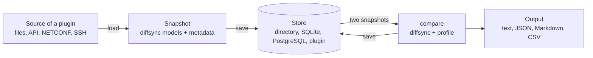

<div align="center">
  <picture>
    <source media="(prefers-color-scheme: dark)" srcset="docs/images/logo-wordmark-dark.svg" />
    
  </picture>
  <p><strong>Snapshot your devices and services, then see exactly what changed</strong></p>
  <p>snapshot &bull; diff &bull; profile &bull; inventory &bull; web UI</p>
  
  
  
  
  
  <p>
    <strong><a href="docs/getting-started.md">Getting started</a></strong> |
    <strong><a href="docs/cli.md">CLI</a></strong> |
    <strong><a href="docs/architecture.md">Architecture</a></strong> |
    <strong><a href="docs/plugins.md">Plugins</a></strong> |
    <strong><a href="docs/profiles.md">Profiles</a></strong> |
    <strong><a href="docs/inventory.md">Inventory</a></strong> |
    <strong><a href="docs/api.md">API</a></strong> |
    <strong><a href="docs/settings.md">Settings</a></strong> |
    <strong><a href="CHANGELOG.md">Changelog</a></strong>
  </p>
</div>

Take a snapshot of anything, then compare two snapshots. A plugin brings the [diffsync](https://github.com/networktocode/diffsync) models and a source: the way to get the data of one target, from input files, an API, NETCONF or SSH. snapdelta saves each load as a snapshot, compares two snapshots on their models, not on text, and shows the diff in a web UI, a CLI and an API.

snapdelta is a plug-in architecture from end to end: the sources, the stores, the output formats, the inventories, the secret backends, the notifiers, the compare rules, the runners and the logins of the web UI are all plugins, the built-in ones included. `snapdelta plugins new` writes a plugin package that works, and `snapdelta doctor` checks it. See [docs/plugins.md](docs/plugins.md).

- **Before and after a change:** snapshot a device, apply the change, snapshot it again, and see exactly what changed.
- **Before and after a migration:** two vendors fill the same models, so the diff shows what the new device does differently, not how each vendor writes it.
- **Between two targets:** two devices of a redundant pair, two sites built from one template, a lab and production.
- **Outside the network:** a service before and after a deployment, two exports of a pipeline, two answers of an API.

## Try it in the web UI

You need Python 3.13 or later and [uv](https://github.com/astral-sh/uv). In a clone of this repository:

```bash
uv sync
uv run snapdelta-web
```

Open the link that it prints, then:

1. **Snapshots**, then **Take snapshot**: source `example-live`, check **All targets**, then **Take snapshot**. The example plugin reads three simulated devices, `R1`, `R2` and `EDGE1`, from `examples/minimal-plugin/devices/`.
2. **New diff**: `R1` on the left, `R2` on the right, then **Compare**.


The diff page shows the two sides, filters and a search, and **Accept** on each change; `?` lists the keyboard shortcuts. The pages are in [docs/web-ui.md](docs/web-ui.md).

## Next steps

| You want to | Read |
|---|---|
| Compare your own data: models, one source per vendor, an inventory, the web UI | [docs/getting-started.md](docs/getting-started.md), step by step |
| See it on a live network: two FRR routers and one Nokia SR Linux in containerlab | [lab/example/README.md](lab/example/README.md) |
| Call it from a pipeline or an AI agent | [docs/api.md](docs/api.md), [docs/mcp.md](docs/mcp.md) |
| Run a shared server in a container, with your plugins | [docs/container.md](docs/container.md) |

## How it works



| Term | Meaning |
|---|---|
| Source | A plugin class that fills diffsync models: from input files, or by fetching from a target (`fetches = True`) |
| Target | What a snapshot describes: a device, a service, an API |
| Snapshot | One load of one target, saved as `TARGET/TIME-LABEL` (`R1/20260101T100000Z-before`); `R1@latest` is the newest of R1, `R1@before` the newest with the label `before`; an optional ticket (`CHG-1042`, `#216`, any text) names the work, and the labels then look inside it |
| Output | The result of one compare, saved as `TIME-LEFT-vs-RIGHT`; `-` is the left value, `+` the right value |
| Store | Where snapshots and outputs go: a directory, a SQLite file, a PostgreSQL database, or a plugin backend |
| Profile | Optional rules of a compare: ignore, tolerance (`"5%"`), counts, pairs of names |
| Inventory | Optional hosts, groups and platforms, which choose the source of each host |

## The CLI

The web UI and the CLI use the same store. The demo above, in the CLI:

```bash
uv run snapdelta snapshot --source example-live --all-targets --label demo
uv run snapdelta diff R1@demo R2@demo
```

[docs/cli.md](docs/cli.md) gives every command, its options, the exit codes and the workflows.

## API

`snapdelta-web` also serves a JSON API under `/api/v1`, for a pipeline or an AI agent: take snapshots before and after a change, compare them (`R1@before` with `R1@after`, or with the target now), read the diff in any format, and give it a ticket and a note. Its OpenAPI description is at `/api/v1/openapi.json`; see [docs/api.md](docs/api.md). The token, the network access and the logins of the web UI, the API and MCP are in [docs/api.md](docs/api.md#access).

```bash
curl -s -X POST http://127.0.0.1:8765/api/v1/diffs -H 'Content-Type: application/json' \
  -d '{"left": "R1@before", "right": "R1@after", "ticket": "CHG-1234"}' | jq .has_differences
```

## AI agents

An agent that talks MCP connects to `snapdelta-mcp` (stdio) or to `/mcp` of `snapdelta-web` (HTTP): tools to take snapshots, compare, read and accept changes, a guide as a resource, and prompts to check a change or review a diff. An agent that runs shell commands uses the skill `skills/snapdelta/SKILL.md`. `/mcp/docs` shows the tools and tries them, as `/api/v1/docs` does for the API. See [docs/mcp.md](docs/mcp.md).

```bash
claude mcp add snapdelta -- snapdelta-mcp --settings /path/to/snapdelta.toml
```

## Settings

snapdelta reads `snapdelta.toml`: the file given with `--settings`, else `SNAPDELTA_SETTINGS`, else `./snapdelta.toml`, else `~/.config/snapdelta/snapdelta.toml`. Every key is in [docs/settings.md](docs/settings.md). `snapdelta settings` shows the values in use, and **Admin > Settings** edits them. The store can hold sensitive data: never commit it to a public repository.

## Guides

| Guide | Content |
|---|---|
| [getting-started.md](docs/getting-started.md) | Your own project, step by step: install, models, one source per vendor, inventory, settings, test data, web UI |
| [cli.md](docs/cli.md) | Every command of the CLI, its options, the workflows and the exit codes |
| [architecture.md](docs/architecture.md) | The parts, a diff step by step, and the extension points |
| [plugins.md](docs/plugins.md) | The plug-in architecture: each extension point, write and check a plugin, contract tests, add an extension point |
| [output.md](docs/output.md) | The output document, the diff tree, the formats, the exit codes |
| [profiles.md](docs/profiles.md) | Ignore, tolerance, counts, pairs: the rules of a compare |
| [inventory.md](docs/inventory.md) | The optional Nornir inventory: groups, platforms, host data |
| [web-ui.md](docs/web-ui.md) | The pages of the web UI, with screenshots |
| [api.md](docs/api.md) | The JSON API for pipelines and AI agents, the token and the network access |
| [mcp.md](docs/mcp.md) | The MCP server and the skill for AI agents |
| [container.md](docs/container.md) | The container image, your plugins in an image of your own, a compose file with PostgreSQL |
| [stores.md](docs/stores.md) | The file and SQLite stores, cleanup, the Python API, plugin backends |
| [parallel.md](docs/parallel.md) | Several targets at the same time, and parallel fetches inside one target |
| [settings.md](docs/settings.md) | Every key, secrets, the settings of a source, the web editor |
| [develop.md](docs/develop.md) | The layout of the repository, the commands, the CI and the assets of the web UI |

## Write a plugin

Every extension point of snapdelta is an entry point group: a source, a store, a format, an inventory, a secret backend, a notifier, a compare rule, a runner or a login. A plugin package declares its plugins in its `pyproject.toml`, and snapdelta finds them once the package is installed.

```bash
snapdelta plugins new acme --kind source --kind store   # a package with a working plugin of each kind, and its tests
snapdelta doctor                                         # each plugin against its interface, then the settings and the store
```

[docs/plugins.md](docs/plugins.md) is the guide: each extension point, how to write and check a plugin, and the contract tests that every plugin of its kind must pass. [docs/getting-started.md](docs/getting-started.md) writes a project with two sources step by step.

## Develop

```bash
uv sync
make test           # uv run pytest
make lint           # ruff and pyright
```

[docs/develop.md](docs/develop.md) gives the layout of the repository, the other commands and the CI.
