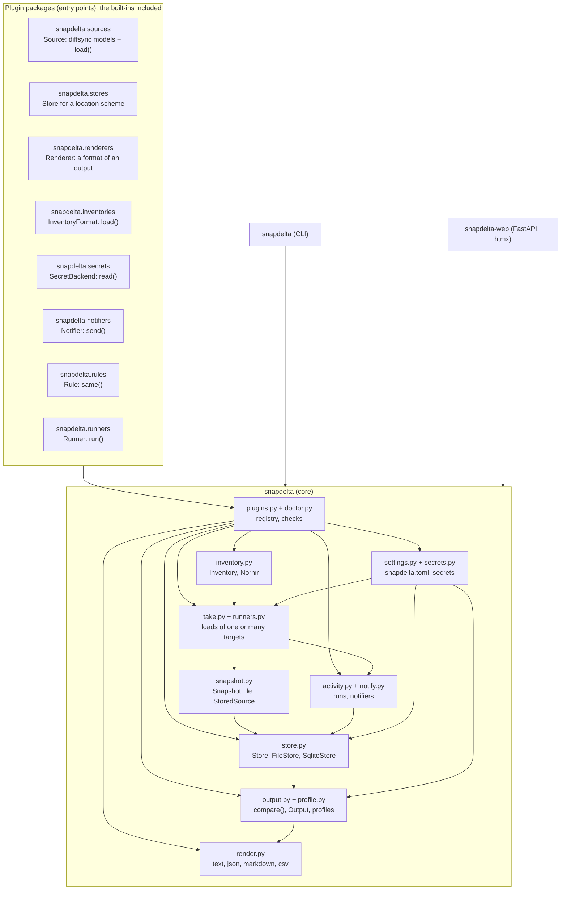

# Architecture

snapdelta is a small core with eight extension points, and the web UI adds a ninth, for its logins. A plugin brings what depends on the data: the diffsync models and the source that fills them. It can also bring a store backend, an output format, an inventory format, a secret backend, a notifier, a compare rule or a runner. The core does the rest: snapshots, compares, stores, formats, the CLI and the web UI.

## Plugin architecture

snapdelta is a plug-in architecture, by design: a small core, and entry point groups that plugins fill: eight of the core, one of the web UI, and one in which a package declares its own extension points. [plugins.md](plugins.md) has the whole guide: each group, how to write and check a plugin, and how to add a group. The rules:

- **The built-ins are plugins too.** The `snapdelta` package declares its stores, formats, inventory format, secret backends, notifiers, compare rules and runners as entry points in its own `pyproject.toml`, and the core finds them through the same registry as an installed plugin, never as a special case.
- **One registry.** `snapdelta.plugins` reads each group once per process. A plugin that cannot load, that is not of the kind of its group, or whose name another package also gives is left out as broken, with its error: the other plugins and the commands that do not need it go on.
- **The store stays pluggable.** The `Store` class is a public interface: the core, the CLI and the web UI use only its methods, never a backend class or a file on disk.
- **A plugin gets what a built-in gets.** A registry entry, its own settings table, its place in `snapdelta plugins`, `snapdelta doctor`, **Admin > Plugins** and the docs, contract tests, and a template in `snapdelta plugins new`.
- **A new extension point needs a use.** Add one when a second implementation is planned, not before.
- **Never remove an extension point** because only the built-ins use it: the groups are part of the product.

## Parts



| Concept | What it is |
|---|---|
| Source | A diffsync adapter of a plugin: its models as class attributes, `top_level`, and `load()`, which reads input files or fetches from a target (`fetches = True`). The entry point name equals `Source.source`. |
| Target | What a load describes: a device, a service, an API. A snapshot belongs to one target. |
| Snapshot | The data of one load and its metadata (target, source, label, capture time, inputs, warnings), saved as a JSON document. `StoredSource` loads it back into the models of its source, so the plugin must stay installed. |
| Output | The result of one compare: the two sides, the compared models, the diffsync summary and `Diff.dict()`, and the profile used. See [output.md](output.md). |
| Store | Where snapshots and outputs go: a directory, a SQLite file, or a plugin backend. See [stores.md](stores.md). |
| Profile | The rules of a compare: ignore, tolerance, counts, pairs, skip one side. See [profiles.md](profiles.md). |
| Renderer | A format of an output: `text`, `json`, `markdown`, `csv`, or a plugin format. |
| Secret backend | Where a password or a token of the settings comes from: `env`, `file`, or a plugin backend. See [settings.md](settings.md#secrets). |
| Notifier | What gets each run that its filter matches: `webhook`, `command`, or a plugin notifier. See [settings.md](settings.md#notifiers). |
| Rule | Two values written in two ways that mean the same, for a profile: `case-insensitive`, `ip-address`, or a plugin rule. See [profiles.md](profiles.md#rules). |
| Inventory | The hosts, their platform and groups: a Nornir directory, or a plugin format. See [inventory.md](inventory.md). |

## A diff, step by step

```mermaid
sequenceDiagram
    actor U as User
    participant C as CLI or web
    participant St as Store
    participant P as Plugin source
    participant D as diffsync
    U->>C: snapdelta diff R1@latest --live --profile change-window
    C->>St: resolve_snapshot("R1@latest"), load_snapshot()
    St-->>C: left StoredSource (models of its source)
    C->>P: load() of target R1 (fetch, parse, add models)
    P-->>C: right Source
    C->>St: save_snapshot(right) as R1/<time>-live
    C->>D: left.diff_from(right, flags) on the models of both sides
    D-->>C: Diff
    C->>C: profile: pairs before, ignore, tolerance, counts after
    C->>St: save_output() as <time>-R1-vs-R1
    C-->>U: output in the chosen format; exit code 0, 1 or 2
```

- The compare uses only the top-level models that both sides loaded; the others are listed as skipped. `--model` narrows it further.
- In a diff, `-` is the left value and `+` the right value: diffsync takes the right side as its source.
- A snapshot and an output never change after the save; a list reads names only, never whole documents.
- Loads run in threads: several targets at once (`--jobs`), and several fetches of one target at once with `fetch_parallel()`. See [parallel.md](parallel.md).

## Where to extend

| Need | Write | Declare in the entry point group |
|---|---|---|
| New data: a vendor, an API, a database | a `Source` subclass with its models | `snapdelta.sources` |
| Its settings (URL, credentials, timeouts) | a `SourceSettings` subclass, set as `settings_class` | none: `[sources.NAME]` in [settings.md](settings.md) |
| Another place for the store | a `Store` subclass with `open(address, settings)` | `snapdelta.stores` |
| Its settings (bucket, credentials, timeouts) | a `StoreBackendSettings` subclass, set as `settings_class` | none: `[stores.SCHEME]` in [stores.md](stores.md#add-a-backend) |
| Another report format | a `snapdelta.render.Renderer` | `snapdelta.renderers` |
| Another inventory (NetBox, Ansible, CSV) | an `InventoryFormat` subclass whose `load()` returns a `snapdelta.inventory.Inventory` | `snapdelta.inventories` |
| Its settings (URL token, filters) | an `InventoryFormatSettings` subclass, set as `settings_class` | none: `[inventories.NAME]` in [inventory.md](inventory.md#other-formats) |
| Another place for secrets (a vault, a keyring) | a `SecretBackend` subclass whose `read()` returns the secret | `snapdelta.secrets` |
| A message after each run (mail, chat, ticket) | a `Notifier` subclass whose `send()` gets the run | `snapdelta.notifiers` |
| Rules for a compare | no code: a `[profiles.NAME]` table | none |
| A login of the web UI and the API: LDAP, OIDC | an `AuthBackend` subclass of `snapdelta_web.auth` | `snapdelta.auth` |
| Loads that run elsewhere: processes, a queue and its workers | a `Runner` subclass whose `run()` gives the outcome of each `LoadTask` | `snapdelta.runners` |
| A value written in two ways that means the same | a `Rule` subclass whose `same()` says so, named in `rules` of a profile | `snapdelta.rules` |

`snapdelta models` (and the web tab Admin > Models) lists the models of the installed sources, grouped by sources with the same models. It names the sources that compare with each group, and warns when two sources use the same model name with other fields: such a compare shows false differences.
