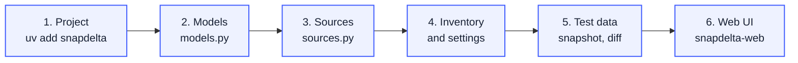
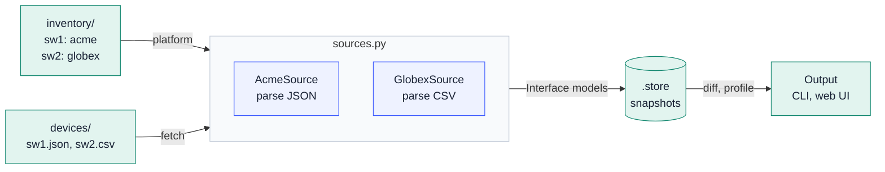

# Getting started: your own snapdelta

This guide builds a snapdelta project for a small network of two vendors, from an empty directory to the web UI. Every command and every file below was run as written. The two vendors are imaginary: Acme switches export JSON, Globex switches export CSV; both fill the same model, so any two switches compare.



What runs when you take a snapshot and compare:



At the end, the project looks like this:

```text
my-snapdelta/
├── pyproject.toml              # the dependencies and the two sources (entry points)
├── snapdelta.toml              # store, inventory, settings of the sources, profiles
├── src/my_snapdelta/
│   ├── __init__.py
│   ├── models.py               # step 2
│   └── sources.py              # step 3
├── inventory/                  # step 4: hosts.yaml, groups.yaml
├── devices/                    # step 5: the exports that the sources read
└── .store/                     # snapshots and diffs (do not commit it)
```

## 1. Create the project and install snapdelta

snapdelta needs Python 3.13 or later and [uv](https://github.com/astral-sh/uv). Create a package project and add the core and the web UI:

```bash
uv init --package --name my-snapdelta my-snapdelta
cd my-snapdelta
uv add snapdelta snapdelta-web
```

In `pyproject.toml`, set `requires-python = ">=3.13"`, and replace the `[project.scripts]` table that `uv init` wrote with the entry points of the two sources of step 3:

```toml
[project.entry-points."snapdelta.sources"]
acme = "my_snapdelta.sources:AcmeSource"
globex = "my_snapdelta.sources:GlobexSource"
```

In `src/my_snapdelta/__init__.py`, replace the `main()` that `uv init` wrote with one line:

```python
"""snapdelta plugin of my network: the models, and one source per vendor."""
```

## 2. Write the models

A model is what you want to compare, the same for every vendor: its identifiers (`name`) and its attributes. Keep the values that mean something and that both vendors give; leave out counters and timestamps that change on every load.

```python
# src/my_snapdelta/models.py
"""What every vendor fills: the same models, so that any two devices compare."""

from diffsync import DiffSyncModel


class Interface(DiffSyncModel):
    """An interface; `vlans` lists the VLANs that it carries, sorted."""

    _modelname = "interface"
    _identifiers = ("name",)
    _attributes = ("description", "enabled", "mtu", "vlans")

    name: str
    description: str | None = None
    enabled: bool = True
    mtu: int | None = None
    vlans: list[int] = []
```

A field that is in neither `_identifiers` nor `_attributes` is kept in the snapshot but never compared: use it for a value that helps to read a device but changes without a fault, such as an uptime, an interface index or a serial number. The web UI shows it in grey, marked **not compared**, in the snapshot tables, the diff cards and **Admin > Models**; `snapdelta models` marks it `(not compared)`.

## 3. Write one source per vendor

A source gets the data of one target and fills the models. Each vendor has its own format, so each has its own `parse()`; the fetch, the models and the settings are shared. Here a "device" is an export file in `data_dir`; a real source calls the API, NETCONF or SSH of `self.host` in `fetch()`.

```python
# src/my_snapdelta/sources.py
"""One source per vendor: each reads its own format and fills the same models."""

import csv
import io
import json
from pathlib import Path

from snapdelta.errors import LoadError
from snapdelta.inputs import InputFile
from snapdelta.settings import SourceSettings
from snapdelta.source import InputRef, Source

from .models import Interface


class DeviceSettings(SourceSettings):
    """`[sources.NAME]`: where the device exports are; a real source would hold a URL and a login here."""

    data_dir: Path = Path("devices")


class DeviceSource(Source):
    """The common part: the models, and the fetch of one export; each vendor parses its own format."""

    fetches = True
    settings_class = DeviceSettings
    suffix = ""

    interface = Interface
    top_level = ["interface"]

    @classmethod
    def targets(cls, settings: SourceSettings | None = None) -> list[str]:
        folder = settings.data_dir if isinstance(settings, DeviceSettings) else DeviceSettings().data_dir
        return sorted(path.stem for path in folder.glob(f"*{cls.suffix}"))

    def fetch(self) -> InputFile:
        """Here the export comes from a file; a real source calls the API, NETCONF or SSH of `self.host`."""
        assert isinstance(self.settings, DeviceSettings)
        path = self.settings.data_dir / f"{self.target}{self.suffix}"
        if not path.is_file():
            raise LoadError(self.target or self.source, f"not reachable (no {path})")
        export = InputFile.from_path(path)
        self.inputs.append(InputRef(name=export.name, sha256=export.sha256))
        return export

    def load(self) -> None:
        for item in self.parse(self.fetch()):
            self.add_or_warn(item)
        self.finish_load(self.target, ["interface"])

    def parse(self, export: InputFile) -> list[Interface]:
        raise NotImplementedError


class AcmeSource(DeviceSource):
    """Acme switches export JSON: {"ports": [{"id", "alias", "admin", "mtu", "vlans"}]}."""

    source = "acme"
    suffix = ".json"

    def parse(self, export: InputFile) -> list[Interface]:
        return [
            Interface(
                name=port["id"],
                description=port.get("alias") or None,
                enabled=port.get("admin") == "up",
                mtu=port.get("mtu"),
                vlans=sorted(port.get("vlans", [])),
            )
            for port in json.loads(export.content)["ports"]
        ]


class GlobexSource(DeviceSource):
    """Globex switches export CSV: name,description,shutdown,mtu,vlans (vlans separated by spaces)."""

    source = "globex"
    suffix = ".csv"

    def parse(self, export: InputFile) -> list[Interface]:
        rows = csv.DictReader(io.StringIO(export.content.decode()))
        return [
            Interface(
                name=row["name"],
                description=row["description"] or None,
                enabled=row["shutdown"] != "yes",
                mtu=int(row["mtu"]) if row["mtu"] else None,
                vlans=sorted(int(vlan) for vlan in row["vlans"].split()),
            )
            for row in rows
        ]
```

Normalize in `parse()`: the same meaning must give the same value on both vendors (`enabled` from `admin: up` and from `shutdown: no`, sorted VLAN lists). Then check that snapdelta finds the sources and their model:

```bash
uv sync
uv run snapdelta sources       # acme  my-snapdelta  fetches, globex  my-snapdelta  fetches
uv run snapdelta models
```

## 4. Add the inventory and the settings

The inventory lists the switches, their group and their platform; the platform chooses the source. It is a Nornir SimpleInventory (see [inventory.md](inventory.md)).

```yaml
# inventory/hosts.yaml
sw1:
  hostname: 192.0.2.11
  platform: acme
  groups: [paris]
sw2:
  hostname: 192.0.2.12
  platform: globex
  groups: [paris]
```

```yaml
# inventory/groups.yaml
paris:
  data:
    site: paris
```

snapdelta reads `snapdelta.toml` in the current directory (see [settings.md](settings.md)). The paths are relative to the file. The platforms `acme` and `globex` are also the names of the sources, so they choose them with no mapping; `[inventory.platforms]` is only for a platform whose source has another name (`junos = "junos-netconf"`).

```toml
# snapdelta.toml
[store]
location = ".store"

[inventory]
location = "inventory"

[sources.acme]
data_dir = "devices"

[sources.globex]
data_dir = "devices"

[profiles.migration]
description = "Acme to Globex: the same ports under other names"
pairs = { "1/1" = "Gi1/0/1", "1/2" = "Gi1/0/2" }
```

```bash
uv run snapdelta inventory     # sw1  acme  acme  paris  192.0.2.11 ...
uv run snapdelta settings
```

## 5. Load test data

Create one export per switch, as the devices would give them. `devices/sw1.json`:

```json
{"ports": [
  {"id": "1/1", "alias": "uplink to core", "admin": "up", "mtu": 9000, "vlans": [10, 20]},
  {"id": "1/2", "alias": "users", "admin": "up", "mtu": 1500, "vlans": [10]}
]}
```

`devices/sw2.csv`:

```text
name,description,shutdown,mtu,vlans
Gi1/0/1,uplink to core,no,9000,10 20
Gi1/0/2,users,no,1500,10 30
```

Take a snapshot of the group, change a device, and compare:

```bash
uv run snapdelta snapshot --group paris --label before    # sw1 with acme, sw2 with globex
```

Now add VLAN 30 to port `1/2` of sw1: in `devices/sw1.json`, change `"vlans": [10]` to `"vlans": [10, 30]`. Then compare sw1 with itself now:

```bash
uv run snapdelta diff sw1@latest --live
```

```text
interface
  ~ 1/2
      vlans: [10] -> [10, 30]

only left: 0, only right: 0, changed: 1, unchanged: 1
```

Compare the two vendors: without a profile, the port names differ, so every port is on one side only; the `migration` profile pairs them, and the two switches are the same:

```bash
uv run snapdelta diff sw1@latest sw2@latest                       # 2 only left, 2 only right
uv run snapdelta diff sw1@latest sw2@latest --profile migration   # no difference
```

## 6. Start the web UI

```bash
uv run snapdelta-web            # http://127.0.0.1:8765
```

- **Snapshots**, then **Take snapshot**: source "By platform (inventory)", group `paris`.
- A snapshot page: **Compare with live**, with the profile `migration` or none.
- **New diff**: the targets, a group filter, the models and a profile.
- **Activity**: each snapshot and diff, from the web UI, the CLI or the API, with the log of its loads.
- **Admin**: the settings, the profiles, the inventory and the models of your sources.

## Next

- Replace `fetch()` with the real access of your devices; `self.host` gives the address, the port and the login from the inventory, and `fetch_parallel()` runs several requests of one device at the same time ([parallel.md](parallel.md)).
- Log what your source does with the standard `logging` module (`log = logging.getLogger(__name__)`, then `log.info(...)`): snapdelta saves the messages of each load with its snapshot, from every thread of `fetch_parallel()`, and shows them in **Activity** and on the snapshot page. `[snapshot] log_level` sets the lowest level that it keeps (`info` by default).
- Add tests on real exports of your devices: load an export with your source and check the models. `snapdelta.testing.SourceContract` adds the tests that every source must pass: two loads of the same data compare equal, a snapshot reads back with no difference, and `snapdelta doctor` finds no error. Give it one fixture (`uv add --dev "snapdelta[testing]"`):

  ```python
  # tests/test_sources.py
  from pathlib import Path

  import pytest
  from snapdelta.testing import SourceContract

  from my_snapdelta.sources import AcmeSource, DeviceSettings


  class TestAcmeSource(SourceContract):
      @pytest.fixture
      def load(self):
          def fetch():
              source = AcmeSource(target="sw1", settings=DeviceSettings(data_dir=Path("devices")))
              source.load()
              return source

          return fetch
  ```

- Run `uv run snapdelta doctor` after each change of the plugin: it checks each source against the interface, then the settings, the inventory and the store.
- Add rules for your change windows: ignore, tolerance, counts ([profiles.md](profiles.md)).
- Call snapdelta from a pipeline or an AI agent: the JSON API of `snapdelta-web` takes snapshots and runs diffs ([api.md](api.md)).
- Add `.store/` to `.gitignore`: a store holds the data of your devices.
