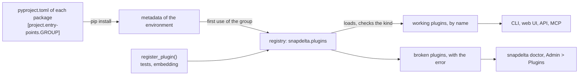

# Plugins

snapdelta is a plug-in architecture, also called a microkernel: a small core, and extension points that plugins fill. The core snapshots, compares, saves and shows. Everything that depends on your data or on your place goes in a plugin: the models and the source of the data, the store, the formats, the inventory, the secrets, the messages after a run, the rules of a compare, how the loads run, and who may use the web UI. The built-in parts are plugins too, so a plugin of another package gets the same means as a built-in one.

## The extension points

Each extension point is a Python [entry point group](https://packaging.python.org/en/latest/specifications/entry-points/). A plugin package declares its plugins in its `pyproject.toml`, and snapdelta finds them when the package is installed.

| Group | Kind | Interface | Built in | How snapdelta chooses one | Settings |
|---|---|---|---|---|---|
| `snapdelta.sources` | source | `snapdelta.source.Source` | none (see `examples/minimal-plugin`) | `--source NAME`, or the platform of a host of the inventory | `[sources.NAME]` |
| `snapdelta.stores` | store backend | `snapdelta.store.Store` | `file`, `sqlite` | the scheme of the location, `SCHEME://ADDRESS` | `[stores.SCHEME]` |
| `snapdelta.renderers` | output format | `snapdelta.render.Renderer` | `text`, `json`, `markdown`, `csv` | `--format NAME`, `?format=NAME` | none |
| `snapdelta.inventories` | inventory format | `snapdelta.inventory.InventoryFormat` | `nornir` | `[inventory] format` | `[inventories.NAME]` |
| `snapdelta.secrets` | secret backend | `snapdelta.secrets.SecretBackend` | `env`, `file` | the key of each secret, `{ NAME = "REFERENCE" }` | `[secrets.NAME]` |
| `snapdelta.notifiers` | notifier | `snapdelta.notify.Notifier` | `webhook`, `command` | every `[notifiers.X]` table whose `type` is the name and whose filter matches the run | `[notifiers.X]`, one table per notifier |
| `snapdelta.rules` | compare rule | `snapdelta.rules.Rule` | `case-insensitive`, `whitespace`, `unordered`, `ip-address` | `rules` of a profile, `"MODEL.ATTRIBUTE" = "NAME"` | none |
| `snapdelta.runners` | runner | `snapdelta.runners.Runner` | `threads`, `processes` | `[snapshot] runner` | `[runners.NAME]` |
| `snapdelta.auth` (of `snapdelta-web`) | auth backend | `snapdelta_web.auth.AuthBackend` | `token`, `header`, `none` | `[web] auth` | `[auth.NAME]` |
| `snapdelta.extension_points` | extension point | `snapdelta.plugins.ExtensionPoint` | `auth` (of `snapdelta-web`) | every one: a package declares its own extension points | none |

The guide of each kind:

| Kind | Guide |
|---|---|
| Source | [getting-started.md](getting-started.md), and `examples/minimal-plugin` |
| Store backend | [stores.md](stores.md#add-a-backend) |
| Output format | [output.md](output.md) |
| Inventory format | [inventory.md](inventory.md#other-formats) |
| Secret backend | [settings.md](settings.md#add-a-secret-backend) |
| Notifier | [settings.md](settings.md#add-a-notifier) |
| Compare rule | [profiles.md](profiles.md#add-a-rule) |
| Runner | [parallel.md](parallel.md#add-a-runner) |
| Auth backend | [api.md](api.md#add-an-auth-backend) |

## Write a plugin

Start from a package that works, then change it:

```bash
snapdelta plugins new acme --kind source --kind store    # writes ./snapdelta-acme
cd snapdelta-acme
uv sync
uv run snapdelta doctor    # the source acme and the store acme:// pass the checks of their interface
uv run pytest              # the contract tests pass
```

`--kind` takes `source`, `store`, `format`, `inventory`, `secret`, `notifier`, `rule`, `runner` and `auth`, and can be given several times. Each kind writes one module with a plugin that works, its entry point in `pyproject.toml`, and its tests. The store is an in-memory backend: replace each of its dicts with your database, and keep its tests green.

A plugin package has three parts:

```toml
# pyproject.toml
[project]
name = "snapdelta-acme"
dependencies = ["snapdelta>=0.1,<0.2"]    # a minor version of snapdelta can change an interface before 1.0

[project.entry-points."snapdelta.sources"]
acme = "snapdelta_acme.source:AcmeSource"    # NAME = "MODULE:OBJECT"

[project.entry-points."snapdelta.stores"]
acme = "snapdelta_acme.store:AcmeStore"
```

1. **The code**: a subclass of the interface of its group (a `Renderer` object for a format).
2. **The entry point**: the name of the plugin, and the object that snapdelta loads. The name of a source must also be the class attribute `source`, because a snapshot names its source.
3. **The settings**, when the plugin has any: a subclass of the settings class of its kind, set as `settings_class`. snapdelta reads the table of the plugin from `snapdelta.toml`, checks the types, shows the values in `snapdelta settings` and edits them in **Admin > Settings**. A password or a token takes a `snapdelta.settings.Secret`, so it can come from any secret backend.

## Check a plugin

| Tool | What it checks |
|---|---|
| `snapdelta plugins` | The plugins of every group, with their package, version and status, and where the settings use each one: `the store`, `[snapshot] runner`, `web.token`, `[profiles.change-window]` |
| `snapdelta doctor` | Each plugin against its interface, then the settings, the store, the inventory, the notifiers and the models of the sources; exit code `1` on an error, `--json` for a pipeline |
| **Admin > Plugins**, `GET /api/v1/plugins` | The same as `snapdelta plugins`, in the web UI and the API |
| `snapdelta.testing` | Contract tests for the tests of a plugin: `StoreContract` and `SourceContract` (`pip install "snapdelta[testing]"`) |

`snapdelta doctor` finds, for example: a source with no `load()`, or a child model that is not a model of the source; a store backend with a method of the interface left with no code, or a `backend` that is not its scheme; a format that fails on a sample diff, or that returns bytes; a rule that fails on two texts; a settings class of the wrong kind.

The contract tests check what a reader of the code can miss. `SourceContract` loads the same data twice and compares the two loads: a list in another order, or a value that changes at each load, is a false difference in every diff. It also saves a snapshot and reads it back, which finds a value that JSON does not keep. `StoreContract` checks the names, `TARGET@label`, the refusal of unsafe names, the outputs and their reviews, pruning, Activity, and a location that opens the same store again. The built-in stores and the example sources pass them.

```python
import pytest
from snapdelta.testing import StoreContract

from snapdelta_acme.store import AcmeStore, AcmeStoreSettings


class TestAcmeStore(StoreContract):
    @pytest.fixture
    def store(self, tmp_path):
        return AcmeStore.open(str(tmp_path / "store"), AcmeStoreSettings())
```

## How snapdelta finds the plugins



- The registry reads each group once per process, at its first use. After you install or change a plugin package, start the CLI command or the web server again. An editable install picks up a change of the code at once, but a new entry point only after `uv sync` or `pip install -e .` again.
- The core finds its own built-ins the same way: the `snapdelta` package declares them in its own `pyproject.toml`.
- `snapdelta.plugins.register_plugin(point, name, value)` adds a plugin without an entry point, for tests and for code that embeds snapdelta. It wins over an installed plugin of the same name, and `unregister_plugin()` takes it back.

## When a plugin is missing or broken

A broken plugin never stops the other plugins, nor the commands that do not need it. The registry keeps it apart, with its error:

| Case | What happens |
|---|---|
| The plugin cannot load: an import error, a missing dependency | Left out with the error, such as `ImportError: no module named boto3` |
| The object is not of the kind of its group | Left out: `not a snapdelta.store.Store subclass` |
| Two packages give the same name in one group | Both left out: `two packages give this name: a, b; uninstall one`, because which one loads would depend on the order of the packages |
| A source whose `source` attribute is not its entry point name | Left out, because its snapshots could not be read again |
| A command needs a broken plugin | It stops with exit code `2`: `the store backend 's3' cannot be used: ImportError: ...` |
| A command needs a plugin that is not installed | It stops with the list of the installed plugins of the group |
| A table of the settings names a plugin that is not installed | A warning: `[sources.ffr]: no source 'ffr' is installed` |
| A notifier fails during its send | The run stays as it is; the run records the error of the notifier |

`snapdelta doctor`, `snapdelta plugins` and **Admin > Plugins** show the broken plugins.

## Add an extension point

This part is for the developers of snapdelta. An extension point is a promise to the authors of plugins, so add one when a second implementation is planned, not before. A built-in implementation and a planned plugin count as two.

1. **The interface**, in the module of its feature: an abstract class whose methods have no code (`abc.abstractmethod`), and a `settings_class` when its plugins have settings.
2. **The extension point**, next to the interface: an `ExtensionPoint` with the group `snapdelta.NAME`, the word for one plugin (`kind`), the interface, the settings table or `None`, a `check` (the kind of the object, with `subclass_check()` for a class) and an `inspect` (the deeper checks of `snapdelta doctor`: `abstract_problems()`, `settings_problems()`, a call on a sample), and an `in_use` (the plugins that the settings use, with where, for `snapdelta plugins`).
3. **The list**: add it to `_core_points()` in `snapdelta/plugins.py`. An extension point of another package, such as `snapdelta.auth` of `snapdelta-web`, is an entry point of the group `snapdelta.extension_points` of that package instead. `snapdelta plugins`, `snapdelta doctor`, **Admin > Plugins** and the API then show it.
4. **The built-ins**, as entry points in `packages/snapdelta/pyproject.toml`, never as a special case in the code.
5. **The settings**: when its plugins have one table each, add the table to `FileSettings` and `Settings` in `snapdelta/settings.py`, so that `snapdelta settings` and **Admin > Settings** show their keys.
6. **The scaffold**: a template of a working plugin and of its tests in `snapdelta/scaffold/kinds/`, and its kind in `KINDS`.
7. **The docs**: a row in the tables above, and a section that shows a plugin.

### Entry points or hooks

Each extension point of snapdelta is an entry point group, with no hook library such as [pluggy](https://pluggy.readthedocs.io/). A group gives either one implementation chosen by a name (a store by its scheme, a format by `--format`, a secret by its key, a rule by a profile), or many that each get the same event (the notifiers, each with its own table and filter). Entry points cover both: the registry gives the plugins by name, and the core calls each one. A hook library becomes useful when many plugins must change the same data in turn, in an order that they declare; no extension point of snapdelta needs that today.

## Compatibility

snapdelta is in beta: until version 1.0, a minor version (0.2, 0.3) can change an interface, and the changelog says how. A plugin depends on one minor version, `snapdelta>=0.1,<0.2`, as `snapdelta plugins new` writes it. A snapshot names its source and keeps the versions of snapdelta and of the package of its source, so keep the plugin installed to read its snapshots.
