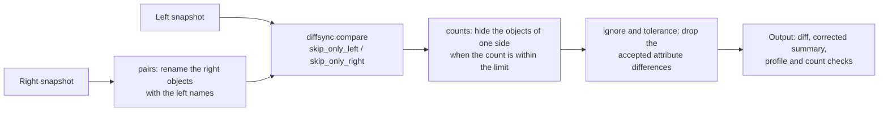

# Compare profiles

A profile gives the rules of a compare: which attributes to ignore, which numbers can change a little, how many objects of a model can come or go, which names pair across two targets, and which side may hold extra objects. diffsync compares values only for equality; a profile adds these rules around it, and the output keeps the profile so that its result can be read again later.

## Write a profile

A profile is a table `[profiles.NAME]` in [`snapdelta.toml`](settings.md). Every key is optional.

```toml
[profiles.change-window]
description = "Change window, counters may move a little"
ignore = ["*.description", "interface_state.lldp_neighbor_port"]
tolerance = { "bgp_peer.prefixes_received" = "5%", "interface.mtu" = 100 }
counts = { bgp_route = "5%" }

[profiles.migration]
ignore = ["*.description"]
pairs = { "ge-0/0/6" = "1/1/1", "ge-0/0/7" = "1/1/2", "ae59" = "lag-59" }
skip_only_right = true
```

| Key | Value | Effect |
|---|---|---|
| `description` | one line, 120 characters at most | Shown next to the name in the profile lists of the web UI, on the diff page and in the outputs. |
| `ignore` | list of `model.attribute` patterns | A difference of a matching attribute is not a difference. |
| `tolerance` | `model.attribute` pattern = limit | A difference of a matching number within the limit is not a difference. |
| `counts` | model = limit | When the number of objects of the model changes within the limit, the objects of one side only of that model are not shown. |
| `pairs` | left name = right name | The right side uses the left names, so two objects with other names compare as one. |
| `skip_only_left` | `true` or `false` | The objects that only the left side holds are not compared. |
| `skip_only_right` | `true` or `false` | The objects that only the right side holds are not compared. |

- A pattern is `model.attribute`; `*` matches any part: `"*.description"`, `"interface_state.*"`.
- A limit is a number (an absolute difference: `100`) or a percent of the left value (`"5%"`). A percent of a left value of 0 allows no change.
- A wrong key, a pattern without `.`, a negative limit or a limit such as `"5 percent"` stops every command with the key and the reason, as for every setting.

## Use a profile

```bash
snapdelta diff R1/20261012T130856Z-before R1@latest --profile change-window
snapdelta diff R1@latest --live --profile change-window
snapdelta diff PE1@latest PE2@latest --profile migration --format markdown
snapdelta settings                                   # shows profiles.NAME.KEY lines
```

In the web UI, the **New diff** page and the **Compare with live** button of a snapshot page have a **Profile** list when the settings hold profiles.

## Edit the profiles in the web UI

**Admin**, then **Profiles**, shows one group per profile, then a **New profile** group.

- `ignore` is one pattern per line; `tolerance`, `counts` and `pairs` are one `KEY = VALUE` per line (`bgp_peer.prefixes_received = 5%`, `ge-0/0/6 = 1/1/1`).
- The `?` next to each field shows its help, and an empty field shows an example. **Admin**, then **Models**, gives the names of the models and attributes (`snapdelta models` in a terminal).
- To add a profile, give its name (letters, digits, `_` and `-`) and its rules in **New profile**. To delete one, check **Remove profile** in its group.
- **Save settings** checks the rules as the CLI does: a wrong line comes back in red on its field, and the file does not change. The other tables of the file and its comments stay.

## How a profile changes a compare



1. **pairs** runs before the compare. The right side becomes a copy where each right name is the left name: in the identifiers (the object `1/1/1` becomes `ge-0/0/6`, its child `1/1/1__0` becomes `ge-0/0/6__0`) and in the string values, lists included (`members_up: ["1/1/1"]` becomes `["ge-0/0/6"]`). A name that does not occur in `pairs` stays as it is. When two right objects get the same name, the compare stops with an error.
2. **skip_only_left** and **skip_only_right** are diffsync flags: the objects of that side only are not compared and not counted as a difference.
3. **counts** compares the number of objects of each listed model on both sides. Within the limit, the objects of one side only of that model leave the diff, with their children; the check records how many (`hidden`). Over the limit, every object stays. A model that one side did not load gets no check.
4. **ignore** and **tolerance** remove the accepted attributes from each changed object. When no attribute is left, the object counts as unchanged; when its children hold no difference either, it leaves the diff.

The summary follows each step, so the counts of the output, the exit code of `diff` (`0` when nothing is left) and the delta strips of the web UI show only the differences that the profile does not accept.

## What the output keeps

The output holds the profile under `profile`: its `name`, its `rules`, and one `counts` entry per count check (`model`, `left`, `right`, `limit`, `within`, `hidden`). So an output read months later still tells which rules hid which differences, even when the settings changed since.

- The text and Markdown formats end with the profile name, its description, and one line per count check: `count bgp_route: 1000 -> 1040 (+40, +4.0%), limit 5%: within, 40 objects of one side not shown`.
- The web diff page shows the profile and its count checks under the counts. In the cards, a value that differs but that the profile accepts keeps its two values and gets the tag `ignored` or `within tolerance`; with `pairs`, the right column shows the right object under its left name.

## Choose the rules

| Goal | Rules |
|---|---|
| Check a change window, where counters move | `tolerance` on the counters (`"bgp_peer.prefixes_received" = "5%"`), `counts` on the large tables (`bgp_route = "5%"`), `ignore` on the values that change on every load (uptime, timestamps) |
| Migrate from one vendor to another | `pairs` for the names that differ (ports, LAGs), `ignore` for the attributes that one vendor does not give |
| Check that a new device holds at least the old config | `skip_only_right = true`: extra objects on the new device are not differences |
| Check that nothing was added | `skip_only_left = true` |

Prefer a fix in the source when a value differs for a reason of format (units, case, defaults): a source that normalizes its values serves every compare, a profile only the compares that use it. Keep profiles for the differences that are real but expected.
