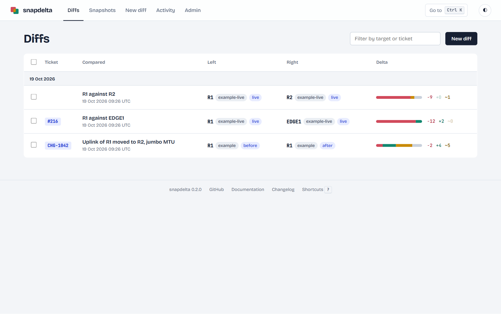
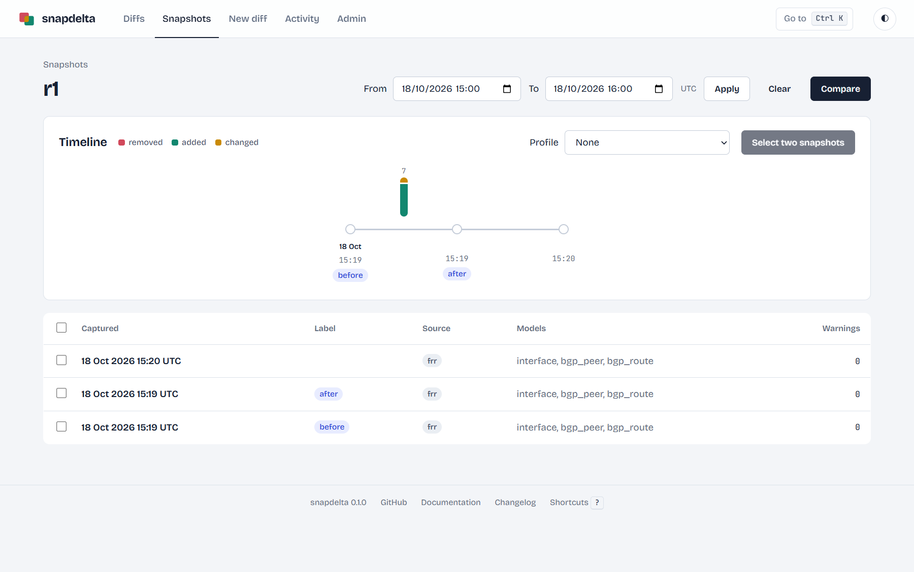
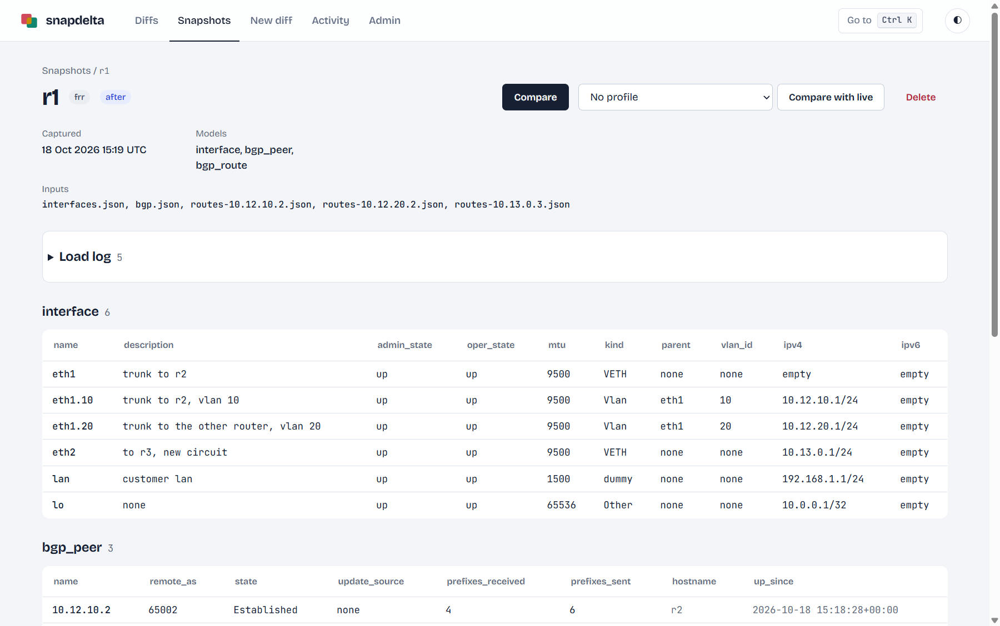
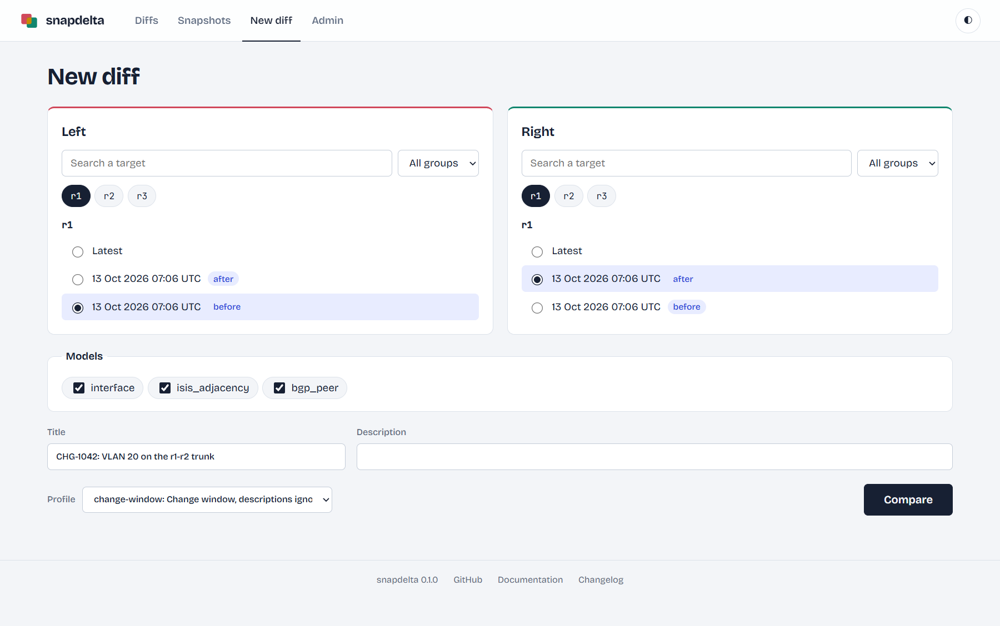
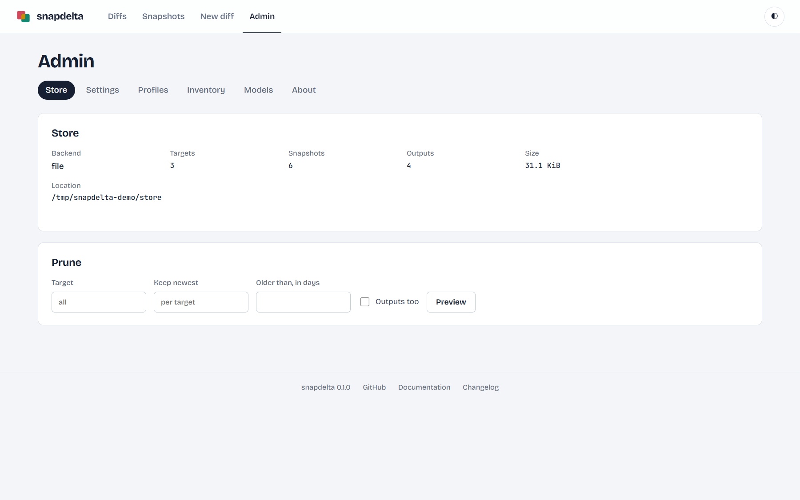
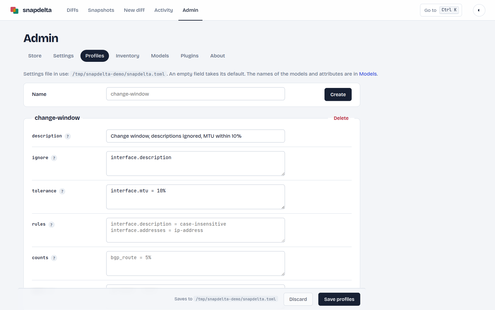
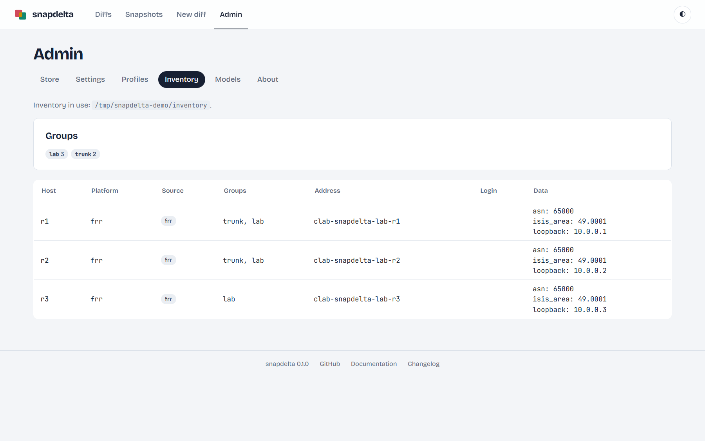
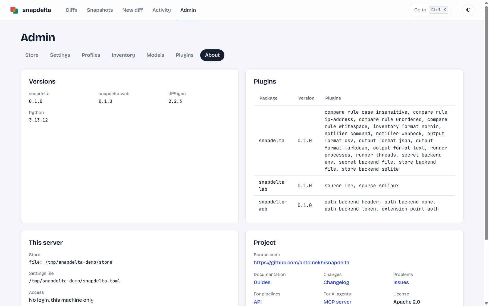

# Web UI

`snapdelta-web` serves the store in a browser: the diffs, the snapshots, a form for a new diff, and the administration. The pages of the diffs come from the example plugin of this repository (`examples/minimal-plugin`), with the ticket CHG-1042 on R1 before and after a change; the other pages come from the lab (`lab/example`).

```bash
snapdelta-web                         # http://127.0.0.1:8765
```

**Ctrl+K** (Cmd+K on a Mac), or **Go to** in the top bar, opens a search of the targets, the diffs (by ticket, note or target) and the pages; the arrows choose, Enter opens. **?**, or **Shortcuts** in the footer, lists every keyboard shortcut.

## A diff


- The ticket, a chip that opens the list of the diffs of that ticket, and the note; **Edit** changes them (fields **Ticket** and **Note**).
- The two sides, left in red and right in green, then the delta strip: only left, only right, changed, unchanged. **All models** gives the counts of the whole diff.
- The chips filter the cards of the selected model; the search finds names and values; both stay in the URL, so a link opens the same view. **Only changed attributes** hides the values that did not change.
- From the keyboard: `j` and `k` go to the next and the previous object, `a` accepts it, `c` copies its link, `o` and `h` switch **Only changed attributes** and **Hide accepted**.
- One card per object: a changed object shows its attributes side by side, the changed ones in colour, and in a long text or a list only the changed words or items are marked; an object of one side only shows its values.
- A field that the model keeps but never compares shows in grey, marked **not compared**, after the attributes.
- **Accept**, at the bottom of each changed object, records that a person checked the change, with an optional comment and the name given in **Your name** (kept in the browser). The counter shows how many changes are accepted; **Hide accepted** leaves the ones to review. The list of diffs shows `✓ 2/3`, and the Markdown report lists the accepted changes.
- The thin rail at the right edge is a map of the changes of the page: one mark per changed object, in its colour, faded once accepted; click a mark to go to the object.
- **#** next to an object copies a link that opens the diff on that object; send it to a colleague.
- **Export** downloads the diff in text, JSON, Markdown or CSV; **API call** copies the `curl` command that reads the diff through the API.

## The diffs



Every saved diff, newest first and by day, with its **Ticket**, the first line of its note, its two sides and a delta strip; the search filters by target or a part of the ticket, and `/diffs?ticket=CHG-1042` (a click on a chip) lists the diffs of exactly that ticket. The ticket is any reference of the work (`CHG-1042`, `#216`, an issue): give it in **New diff**, in **Take snapshot**, with `--ticket`, or later on the page of the diff.

## The snapshots

**Snapshots** lists every snapshot of every target in one table, newest first, 50 per page: **Captured** (a link to the snapshot), **Target** (a link to the page of the target), **Label**, **Ticket** (a chip that lists the snapshots of exactly that ticket) and **Source**. **Target**, **Label** and **Ticket** filter the table as you type, and stay in the URL. **Target** is a picker of chips, the same as the one of **Take snapshot**: the search field lists the targets of the store, a click adds a chip, and unticking a chip removes it; with no chip, the table lists every target. `/snapshots?target=r1&target=r2&label=before&ticket=CHG-1042` lists the `before` snapshots of that ticket for `r1` and `r2`, and the first row is the newest. A label matches as the reference writes it, so `before swap` and `before_swap` are the same, and a ticket matches in any case.

## The snapshots of a target



The page of a target starts with its **timeline**: the 40 newest snapshots as dots on one line, oldest on the left, each with its time (a link to the snapshot) and its label. Between two dots, a capsule shows the delta from one snapshot to the next, in red (removed), green (added) and amber (changed), with its count; its height grows with the square root of the count, so a small change stays visible. A profile hides the changes that it accepts. Click a capsule to select its two snapshots, or click any two dots: the older one becomes the left side (red), the newer one the right side (green), then **Compare** opens the diff. When the timeline holds more snapshots than the page shows, the edge on that side fades: scroll to see them. The table under the timeline lists every snapshot. **From** and **To**, in UTC, keep the snapshots of one period, in the timeline and in the table. Tick rows of the table, or of the list of diffs, and a bar at the bottom of the screen gives their count, **Clear** and **Delete**; a delete keeps the period. On the page of a target, the bar also has **Compare**, which opens the diff of two ticked snapshots, the older one on the left.

## Take snapshots

**Snapshots**, then **Take snapshot**: in the **Targets** box, a source (or "By platform (inventory)"), the targets, all targets or groups; then a label and a ticket. The form has the same style as **New diff > Many targets**. The snapshot runs in the background, and its page follows each target live: queued, running, then saved with a link to its snapshot, or failed with its error, with the time it took. When targets failed, **Retry the failed** takes them again with the same source, label and ticket. Activity keeps the run and the log of its loads.

## A snapshot



The label and the ticket (a chip that lists the snapshots of that ticket), the metadata of the load (time, models, inputs, warnings), then one table per model. **Export** downloads the snapshot as JSON; **API call** copies the `curl` command that reads it through the API. **Compare** opens a new diff from this snapshot; **Compare with live** fetches the target now and compares, with a profile or none.

## A new diff



A switch at the top gives **One target** (the default) or **Many targets**.

**One target**: choose a target, then a snapshot, for **Before** and **After**; with an inventory, a group list filters the targets. The After side takes the target of the Before side until you choose another one for it. Then the models in common, a ticket, a note and a profile. **⇄** between the two sides swaps them.

**Many targets** compares `TARGET@BEFORE` with `TARGET@AFTER` for each host of a group (the page lists its hosts), or for each target of the store that has a Before snapshot; **Now** on the After side takes it from the targets, at the same time. It has the same ticket, note and profile as One target, and gives them to each diff; with a ticket, the labels of Before and After name the snapshots of that ticket only. The page that follows lists each target as changed, unchanged or failed, with the link of its diff.

## Activity

Each command is a run: a snapshot of one or more targets, or a saved diff, from the web UI, the CLI, the API or MCP. **Activity** lists the newest runs with their origin, their targets, their result (OK, Partial when some targets failed, Failed) and the size of their log; a run page shows its snapshots, its diff, the error of each failed target and the log of its loads, from a chosen level. **Result**, **From** and **To** (UTC) filter the 1,000 newest runs. The store keeps the 1,000 newest runs; a prune by age in **Admin** deletes the older ones too.

The log holds the messages that the source plugins write with the standard `logging` module during a load, each with its target. The page of a snapshot shows the log of its own load. The store keeps the newest 1000 runs; `[snapshot] log_level` sets the lowest level that is kept.

## Administration

| Tab | Content |
|---|---|
| Store | The backend, the counts (snapshots, outputs, runs) and the size of the store; pruning with a preview |
| Settings | The settings file, with the origin of each value; links to its sections, and a menu for a field with known values (`log_level`, and the installed runners, auth backends and inventory formats) |
| Profiles | One group per profile, with help on each field |
| Inventory | The groups, and each host with its platform, source and data |
| Models | The models of the installed sources: identifiers, attributes, fields not compared, children |
| Plugins | Every plugin of each extension point: its package, its version, and the problems that `snapdelta doctor` finds |
| About | The versions, the plugin packages, this server and the project links |









## Access

By default, the web UI listens on 127.0.0.1 only and needs no login. To open it on the network, set a token: the pages then ask for it once, and the API needs it too. On an isolated network, `auth = "none"` removes the login. See [api.md](api.md#access).
