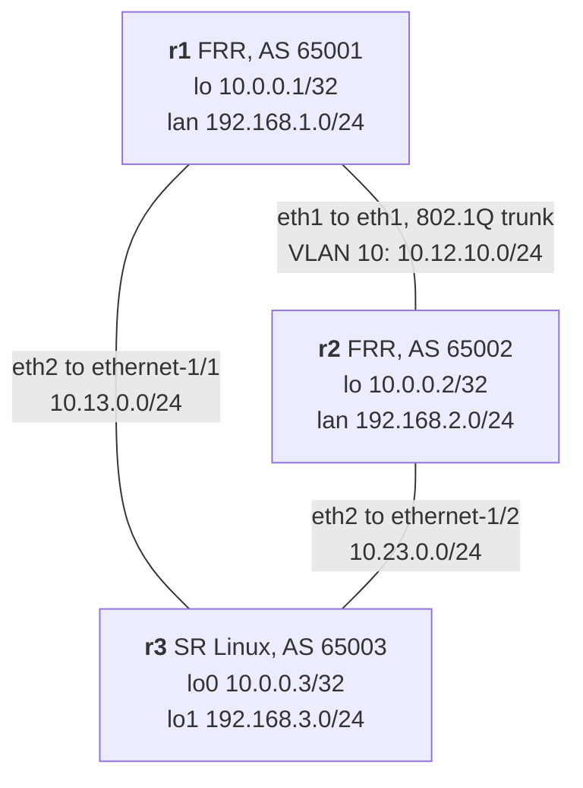
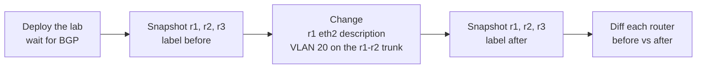
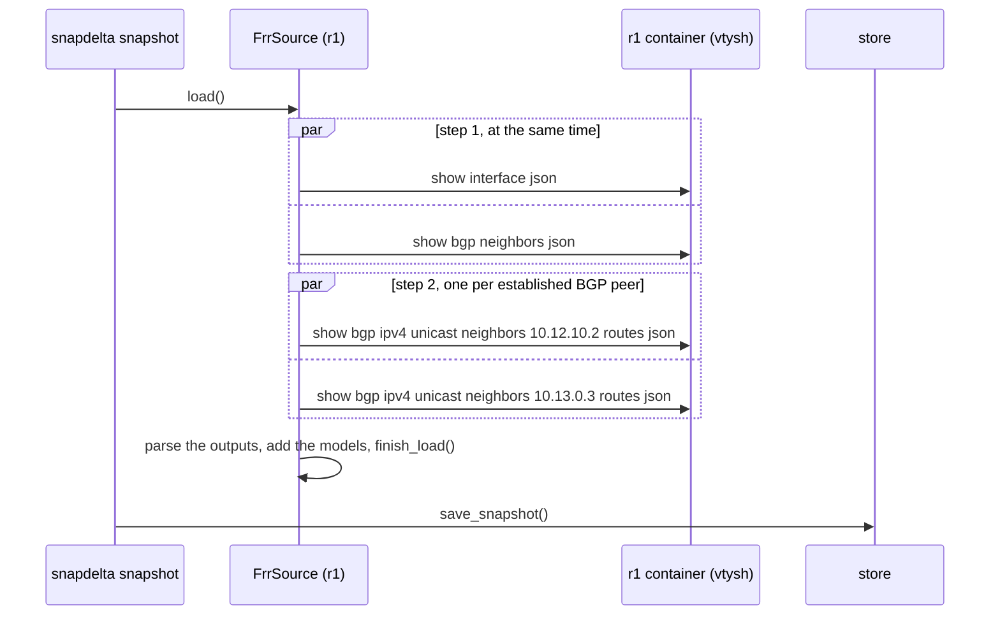
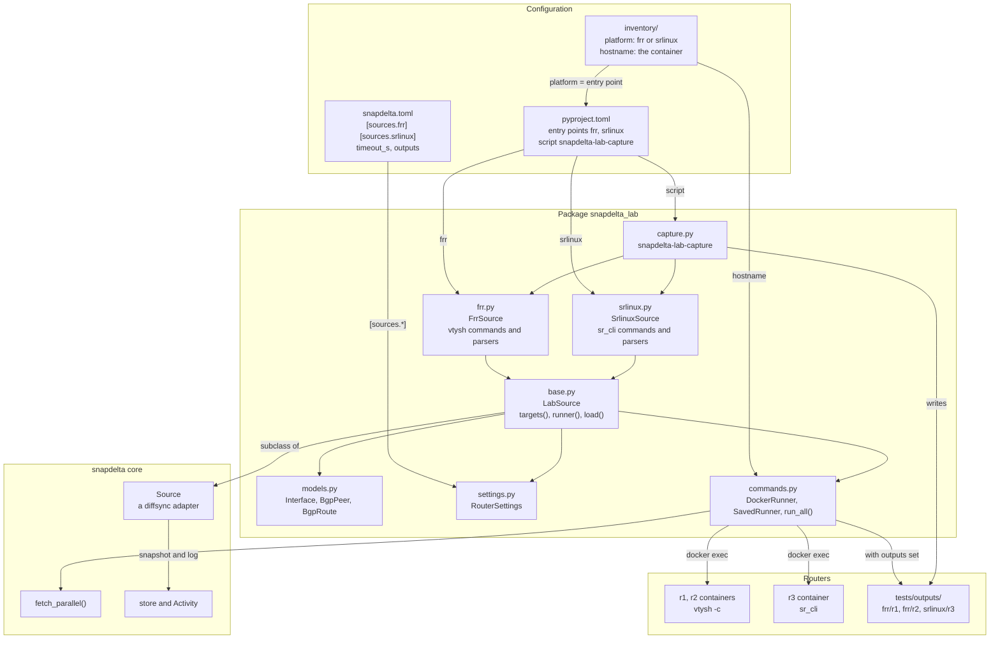
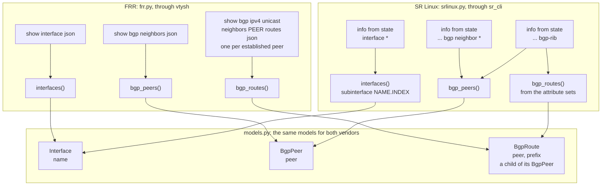

# snapdelta lab: FRR and Nokia SR Linux

A full example of snapdelta on a live network with two vendors: two FRR routers and one Nokia SR Linux router in containerlab, one source per vendor that fills the same models, and a scenario that takes a snapshot before and after a change and compares them. Every step works in the CLI and in the web UI.

## The lab



| Item | Value |
|---|---|
| Topology | `snapdelta-lab.clab.yml`: r1 and r2 run `quay.io/frrouting/frr:10.7.1`, r3 runs `ghcr.io/nokia/srlinux:26.3.2`; management network `172.30.30.0/24` |
| Configs | `configs/r1/frr.conf`, `configs/r2/frr.conf` (with `configs/daemons`: `bgpd` only), `configs/r3/config.cli` (SR Linux CLI commands) |
| BGP | eBGP on each link, one AS per router; each router announces its loopback and its LAN, and passes on the routes that it learns |
| Trunk | r1 `eth1` and r2 `eth1` carry 802.1Q; the r1-r2 session runs on `eth1.10` (VLAN 10) |

The containerlab `exec` lines create the VLAN sub-interfaces and the `lan` dummy interfaces of the FRR routers; FRR gives them their addresses. On SR Linux, the loopback is `lo0` and the LAN is `lo1`, each with its subinterface `.0`. The FRR routers set their own DNS domain (`snapdelta.lab`), so the BGP outputs do not hold the domain of the machine that runs the lab.

## The scenario



The change:

- on r1, the description of `eth2` becomes `to r3, new circuit`;
- on r1 and r2, VLAN 20 is added on the trunk: interface `eth1.20`, addresses `10.12.20.1/24` and `10.12.20.2/24`, and a second eBGP session between r1 and r2 on it.

Expected result: r1 shows the new description, the new interface, and the new BGP peer `10.12.20.2` with its 4 routes; r2 shows the new interface and the new peer `10.12.20.1` with its routes; r3 shows no difference: the routes that it receives keep the same AS paths and next hops.

## Requirements

- Docker and containerlab 0.80 or later; your user can run `containerlab deploy`.
- The SR Linux image: `docker pull ghcr.io/nokia/srlinux:26.3.2` (about 2.3 GB). SR Linux needs about 2 GB of memory and a minute to boot.
- `uv` and `jq`.
- The host kernel supports VLAN (`8021q`) and `dummy` interfaces.

## Install

```bash
cd lab/example
uv sync
uv run snapdelta sources
```

`snapdelta sources` prints `frr  snapdelta-lab  fetches` and `srlinux  snapdelta-lab  fetches`: the two sources are installed and fetch their data themselves. The lab is its own uv project: it depends on the core packages by path (`../../packages/...`), and the workspace of the repository excludes it.

## Configure the store and the settings

All the commands of this guide run in `lab/example`, so snapdelta reads the settings file of the lab, [`lab/example/snapdelta.toml`](snapdelta.toml). It sets the store, the parallel snapshots, the inventory and the two sources; its comments explain each key, and a commented key shows its default.

| Key | Value in the lab | Effect |
|---|---|---|
| `store.location` | `.store` | the snapshots and diffs go to `lab/example/.store`, one JSON file each (file store); the path is relative to the file |
| `stores.sqlite.busy_timeout_s` | default, 30 | SQLite only: how long a writer waits for the lock |
| `snapshot.jobs` | `3` | `--all-targets` fetches the three routers at the same time |
| `web.*` | defaults | port 8765 |
| `inventory.location` | `inventory` | the inventory of the lab (see The inventory) |
| `sources.frr.timeout_s` | `10` | each vtysh command stops after 10 seconds |
| `sources.srlinux.timeout_s` | `20` | each `sr_cli` command stops after 20 seconds |
| `sources.*.outputs` | not set | read saved outputs instead of the live lab (see Run without Docker) |
| `profiles.change-window` | ignore, tolerance | a compare profile: descriptions ignored, MTU within 10% ([docs/profiles.md](../../docs/profiles.md)) |

Check the values in use and where each one comes from:

```bash
uv run snapdelta settings
```

**Use the SQLite store instead.** Change `store.location` to `sqlite://.store/snapdelta.db` (the commented line), in the file or in the web UI (Admin, then Settings, field `location`, then **Save settings**). snapdelta creates the database on first use; `uv run snapdelta info` then says `backend: sqlite`. To copy the snapshots that you already took into the new store, see "Move a store to the other backend" in [docs/stores.md](../../docs/stores.md).

**Use another store for one command.** `SNAPDELTA_STORE` and `--store` win over the file: `uv run snapdelta --store /tmp/lab-store list`, or `SNAPDELTA_STORE=/tmp/lab-store scripts/lab.sh scenario`.

**Run without Docker.** The lab ships the outputs of the three routers in `tests/outputs`, one directory per source, then one per router. To use them instead of the live lab, edit three lines of `snapdelta.toml`:

- in `[store]`, replace `location = ".store"` with the commented line `location = ".store-saved"`, so these snapshots never mix with the snapshots of the live lab;
- in `[sources.frr]` and in `[sources.srlinux]`, uncomment `outputs = "tests/outputs"`.

Then every command of this guide works without Docker; `uv run snapdelta settings` shows `sources.frr.outputs` with the origin `file`. Put the lines back to use the live lab again.

`[sources.frr]` and `[sources.srlinux]` hold the settings of the sources, declared by `RouterSettings` in `src/snapdelta_lab/settings.py`. All the keys are in [docs/settings.md](../../docs/settings.md).

## The inventory

`inventory/` is a Nornir inventory of the three routers (see [docs/inventory.md](../../docs/inventory.md)):

| Host | Platform | Groups | hostname (the container) | data |
|---|---|---|---|---|
| r1 | `frr` | `trunk`, `lab` | `clab-snapdelta-lab-r1` | asn 65001, loopback 10.0.0.1 |
| r2 | `frr` | `trunk`, `lab` | `clab-snapdelta-lab-r2` | asn 65002, loopback 10.0.0.2 |
| r3 | `srlinux` | `lab` | `clab-snapdelta-lab-r3` | asn 65003, loopback 10.0.0.3 |

The platform of a host is the name of its source, so one command takes the three routers of the two vendors; the source runs its commands in the container that `hostname` names. `trunk` holds the two ends of the 802.1Q trunk that the scenario changes.

```bash
uv run snapdelta inventory
uv run snapdelta snapshot --all-targets --label before     # r1 and r2 with frr, r3 with srlinux
uv run snapdelta snapshot --group trunk --label before     # r1 and r2 only
```

In the web UI, Take snapshot offers the source "By platform (inventory)" and the groups `lab` and `trunk`; New diff filters the targets by group; Admin > Inventory shows the routers.

## Run it all at once

```bash
scripts/lab.sh scenario
```

The script deploys the lab from scratch, takes the `before` snapshots, applies the change, takes the `after` snapshots and prints the diff of each router. The snapshots and diffs go to the store of the settings file (`lab/example/.store`); set `SNAPDELTA_STORE` to use another store, for example `SNAPDELTA_STORE=sqlite:///tmp/lab.db scripts/lab.sh scenario`. `scripts/lab.sh --help` lists every command.

## Step by step in the CLI

All the commands run in `lab/example`, so snapdelta reads the settings file of the lab (see [Configure the store and the settings](#configure-the-store-and-the-settings)): the store is `lab/example/.store`, with no `--store` option.

1. Deploy the lab and wait for BGP:

   ```bash
   scripts/lab.sh deploy
   ```

   It ends with `BGP established with routes on every router after 90s`.

2. Take a snapshot of every router, at the same time:

   ```bash
   uv run snapdelta snapshot --all-targets --label before
   ```

   ```
   saved r1/20261013T183026Z-before
   loaded: interface, bgp_peer, bgp_route
   ...
   saved r3/20261013T183028Z-before
   ```

   For one router only: `--target r1`. `--jobs N` sets how many routers load at the same time; without it, `snapshot.jobs` of the settings file applies (3 in the lab).

3. Apply the change:

   ```bash
   scripts/lab.sh change
   ```

   It waits until the new BGP session on `eth1.20` is up.

4. Take the `after` snapshots:

   ```bash
   uv run snapdelta snapshot --all-targets --label after
   ```

5. Compare before and after for r1 (`r1@before` is the newest snapshot of r1 with the label `before`):

   ```bash
   uv run snapdelta diff r1@before r1@after --title "CHG-1042: VLAN 20, r1"
   ```

   ```
   title: CHG-1042: VLAN 20, r1

   left:  r1 [before] frr 2026-10-13T18:30:26+00:00
   right: r1 [after] frr 2026-10-13T18:30:31+00:00

   interface
     + eth1.20
     ~ eth2
         description: "to r3" -> "to r3, new circuit"
   bgp_peer
     + 10.12.20.2
         bgp_route
           + 10.12.20.2__10.0.0.2/32
           + 10.12.20.2__10.0.0.3/32
           + 10.12.20.2__192.168.2.0/24
           + 10.12.20.2__192.168.3.0/24

   only left: 0, only right: 6, changed: 1, unchanged: 14
   ```

   `-` is the left value and `+` the right value. The exit code is 1 because there are differences (0: no difference, 2: error), so a script can test it.

6. Compare two vendors: r1 (FRR) and r3 (SR Linux) fill the same models, so they compare like two snapshots of one router:

   ```bash
   uv run snapdelta diff r1@after r3@after --model bgp_peer --no-save
   ```

7. Read a snapshot, or one model of it:

   ```bash
   uv run snapdelta show r3@latest
   uv run snapdelta show r3@latest --model interface
   ```

8. Read a saved diff again, in another format (`json`, `markdown`, `csv`), and accept its changes after a review:

   ```bash
   uv run snapdelta list
   uv run snapdelta output NAME --format markdown
   uv run snapdelta accept NAME --all --comment "planned in CHG-1042"
   ```

9. Clean up the store:

   ```bash
   uv run snapdelta info                        # backend, location, counts, size
   uv run snapdelta prune --keep 1 --dry-run    # what would go: all but the newest snapshot of each router
   ```

10. Remove the lab:

    ```bash
    scripts/lab.sh destroy
    ```

## Step by step in the web UI

1. Deploy the lab (`scripts/lab.sh deploy`), then start the web UI in `lab/example`, so it reads the same settings file and store:

   ```bash
   uv run snapdelta-web
   ```

   It prints the link of the web UI, `http://127.0.0.1:8765/diffs`: open it in your browser.

2. **Snapshots**, then **Take snapshot**. The source is "By platform (inventory)": each router uses the source of its platform. Check **All targets**, type the label `before`, then **Take snapshot**. The page of the job follows the three routers live, then links each saved snapshot; SR Linux answers last.

3. In a terminal, apply the change: `scripts/lab.sh change`.

4. **Take snapshot** again, with **All targets** and the label `after`.

5. **New diff**: pick `r1` on the left, then **Before → after** selects its `before` and `after` snapshots. Give a title, then **Compare**.

6. The diff page: the two sides, the delta strip, the chips and the search that filter the objects, the change map at the right edge, and **Accept** on each change. `?` lists the keyboard shortcuts; see [docs/web-ui.md](../../docs/web-ui.md).

7. **Snapshots**, then `r1`: the timeline shows the size of each change from one snapshot to the next.

## What snapdelta reads

Both sources fill the same three models, so a diff can compare two vendors. The values follow one convention: `admin_state` is `up` or `down`, a BGP `state` is written `Established`, an `origin` is `IGP`.

| Model | Identifiers | Attributes | FRR command | SR Linux command |
|---|---|---|---|---|
| `interface` | name | description, admin and oper state, MTU, kind, parent, VLAN id, IPv4 and IPv6 addresses | `show interface json` | `info from state interface * \| as json`; a subinterface is `NAME.INDEX` |
| `bgp_peer` | peer | remote AS, state, update source, prefixes received and sent | `show bgp neighbors json` | `info from state network-instance default protocols bgp neighbor * \| as json` |
| `bgp_route` (child of `bgp_peer`) | peer, prefix | next hop, AS path, local preference, MED, origin, best | `show bgp ipv4 unicast neighbors PEER routes json` | `info from state network-instance default bgp-rib \| as json` |

`bgp_peer` also keeps `hostname` and `up_since`, which are never compared: they help to read a snapshot, and a session that restarts changes `up_since`.

Values that change with each deployment are left out, so two deployments of the same configuration give no difference: the management interfaces (`eth0`, `mgmt0`), IPv6 link-local addresses, timers and counters. SR Linux lists every port of the chassis; the source leaves out a port that is disabled and has no subinterface. A route whose AS path holds the own AS of the router is not counted, as FRR does not accept it either.

## How one load works



The SR Linux source has one step: its three commands run at the same time, and the RIB holds the routes of every peer. Both use `fetch_parallel()` from the snapdelta core. With `--all-targets`, the three routers also load at the same time. When a command fails, the load fails with one error that names every failed command, and no snapshot is saved for that router; the other routers are still saved. See [docs/parallel.md](../../docs/parallel.md).

## How the files fit together

The configuration names the sources and the routers; the plugin package holds one module per vendor on a common base; the snapdelta core runs the loads; the routers, or their saved outputs, answer the commands.



Read it from the top: an inventory host has a platform, the entry point of that name gives its source, and the source runs its commands through `commands.py`, in the container that the host names, or in the saved outputs when `outputs` is set.

## From a router command to a model

Each vendor has its own commands and parsers; both fill the same three models, which is why a router of one vendor compares with a router of the other.



The SR Linux `bgp_peers()` reads the RIB too: it counts the routes of each peer that the import kept, as FRR counts its accepted prefixes. The two FRR steps run one after the other, because the routes need the list of established peers; the three SR Linux commands run at the same time.

## The code

| Path | Content |
|---|---|
| `snapdelta-lab.clab.yml` | containerlab topology |
| `configs/` | FRR configs and daemons file, SR Linux CLI config |
| `snapdelta.toml` | settings of the lab: store, parallel snapshots, inventory, the `frr` and `srlinux` sources |
| `scripts/lab.sh` | `deploy`, `destroy`, `wait`, `change`, `scenario`, `capture` |
| `pyproject.toml` | the entry points `frr` and `srlinux` in the group `snapdelta.sources`, and the command `snapdelta-lab-capture` |
| `src/snapdelta_lab/models.py` | the diffsync models, the same for both vendors: `Interface`, `BgpPeer` with its `BgpRoute` children |
| `src/snapdelta_lab/base.py` | `LabSource`: the models, the settings, the targets (containers by containerlab kind) and the steps of a load |
| `src/snapdelta_lab/frr.py` | `FrrSource`: the vtysh commands and their parsers |
| `src/snapdelta_lab/srlinux.py` | `SrlinuxSource`: the `sr_cli` commands and their parsers |
| `src/snapdelta_lab/commands.py` | `DockerRunner` (live, `docker exec`), `SavedRunner` (saved outputs), `run_all()` |
| `src/snapdelta_lab/capture.py` | `snapdelta-lab-capture`: save the outputs of the running routers |
| `src/snapdelta_lab/settings.py` | `RouterSettings`: `timeout_s` and `outputs` of each source |
| `tests/` | tests on the saved outputs in `tests/outputs/` |

To add a vendor, write one more subclass of `LabSource`: its containerlab kind, the command line of its CLI, its commands, and parsers that fill the same models. Test the parsers on saved outputs.

## Tests without the lab

`tests/outputs/` holds the JSON outputs of the three routers, saved from a live lab with `scripts/lab.sh capture` (`snapdelta-lab-capture`), in `tests/outputs/SOURCE/ROUTER/`. The tests give the sources `RouterSettings(outputs=...)`, so they read the saved outputs and need no Docker:

```bash
uv run pytest
```

The capture leaves out what changes with each deployment or describes the host: the DNS domain in the FRR outputs, the counters and the MAC addresses in the SR Linux outputs.

## Troubleshooting

| Symptom | Fix |
|---|---|
| `Requested subnet(s) ... overlap an existing Docker network` | Another Docker network uses `172.30.30.0/24`: change `mgmt.ipv4-subnet` in `snapdelta-lab.clab.yml`. |
| `scripts/lab.sh` stops with `BGP established with routes on every router after 180s` | Check `docker exec clab-snapdelta-lab-r3 sr_cli "show network-instance default protocols bgp neighbor"` and `docker exec clab-snapdelta-lab-r1 vtysh -c "show bgp summary"`; raise `WAIT_S` on a slow machine. |
| r3 restarts, or `sr_cli` does not answer | SR Linux needs about 2 GB of memory: free some, then `scripts/lab.sh deploy`. |
| `snapdelta snapshot` prints `error: parallel fetch: interfaces: r1: show interface json: Error response from daemon: No such container: clab-snapdelta-lab-r1; ...` | The lab is not running, or the router name is wrong: `scripts/lab.sh deploy`, then `docker ps`. |
| `--all-targets` prints `source 'frr' lists no target` | No container has the label `containerlab=snapdelta-lab`: deploy the lab. |
| The web UI shows an old layout | Reload the page: static files are linked with a hash of their content, so a reload gets the new version. |
